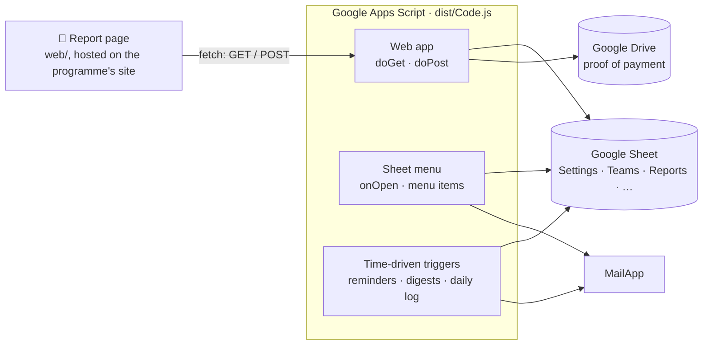

<div align="center">

# ScriptKit

**The Revenue Accelerator's weekly reporting system.**

Teams report on schedule, get instant feedback, and keep their mentors in the loop,
all running on Google Sheets and Apps Script.

[](https://github.com/PRINCEdevon/ScriptKit/actions/workflows/ci.yml)


[Contributing](CONTRIBUTING.md) &nbsp;·&nbsp; [Security](SECURITY.md) &nbsp;·&nbsp; [Code of Conduct](CODE_OF_CONDUCT.md) &nbsp;·&nbsp; [Agent Instructions](AGENTS.md)

</div>

<!-- -------------------------------------------------------------------------- -->

### About This Project

---

**A simple reporting system for accelerator programmes.** <br/>
Teams in an accelerator programme send a short report on scheduled days and get instant
feedback, while their mentors and the programme manager are kept up to date by email.

It runs entirely on tools the programme already has:

- **Google Sheets** <br/>
  The database and the admin screen: every tab is a table the programme manager can read.
- **Google Apps Script** <br/>
  The serverless backend: a web app for the report page, a menu inside the Sheet, and
  time-driven triggers that run like cron jobs to send reminders and digests.
- **A simple web page** <br/>
  The report form is plain HTML, CSS and JavaScript, hosted on the programme's own website.
- **This repository** <br/>
  The development environment: typed code, tests that run without Google, CI, and
  instructions for AI coding agents.

One copy runs per programme. Everything that differs between programmes (name, time zone,
currency, email switches) lives in the Sheet's Settings tab, not in code.

> [!NOTE]
> **Status: migrated, not yet live** <br/>
> The app was moved from one 1,425-line `Code.gs` into typed modules without changing
> behaviour, and the original is kept in `legacy/` as the reference the tests compare against.
> Live programmes still run the original until the
> [go-live checklist](docs/migration-plan.md#going-live) is complete.

<br/>

<!-- -------------------------------------------------------------------------- -->

### How It Works

---



> [!TIP]
> **Three things about Apps Script shape this repository** <br/>
>
> - **There are no modules at runtime** <br/>
>   Every file in a script project shares one global scope, and Apps Script finds `doGet`,
>   `doPost`, `onOpen`, menu handlers and triggers by looking for top-level functions with
>   those names.
> - **The build bridges the gap** <br/>
>   `scripts/build.js` bundles `src/` with esbuild into one script and adds a top-level
>   function for each export of `src/main.ts`. Exporting a function from `main.ts` is how it
>   becomes an entrypoint.
> - **Google services are globals** <br/>
>   Types come from `@types/google-apps-script`, and `src/` is type-checked without Node.js
>   types, because Node APIs do not exist in Apps Script.

> [!IMPORTANT]
> **The report page is deployed separately** <br/>
> It lives in [`web/`](web/) as plain HTML, CSS and JavaScript, is uploaded to the programme's
> website, and talks to the web app with `fetch`. Changing the web app's requests or replies
> can break the live page: [web/README.md](web/README.md) describes the contract it depends on.

<br/>

<!-- -------------------------------------------------------------------------- -->

<details>
  <summary><strong>Features</strong></summary>
  <br/>

- **Private team links** <br/>
  Each team reports through its own link: no accounts or passwords to manage.

- **Reports straight into the Sheet** <br/>
  Every report becomes a row in the programme's Google Sheet, checked as it is typed and again
  when it arrives.

- **Proof of payment** <br/>
  Teams attach receipts and screenshots, filed in Google Drive in a folder per team.

- **Instant feedback** <br/>
  Straight after sending, teams get tailored notes from rules the programme manager can reword,
  reorder or switch off in the Sheet.

- **Sales pipeline tracking** <br/>
  Teams selling to organisations list their potential customers and stages; the app spots
  progress, new leads and deals that have stalled.

- **History and scoreboard** <br/>
  Each team sees its past reports, replies and corrections, and a cohort scoreboard that ranks
  by activity early on and by money from the checkpoint week.

- **Email that runs itself** <br/>
  Reminders on the due day, Tuesday digests for mentors and a summary for the programme
  manager, all sent on schedule.

- **Replies from the Sheet** <br/>
  The programme manager types a reply next to a report and ticks a box; the team gets it by
  email, copied to their mentor.

- **An admin menu in the Sheet** <br/>
  Team links, this week's reports, the report log, setup and repair, demo data and a
  permissions check, one click away.

- **Safe to try out** <br/>
  A test mode sends every email to one inbox, a pretend date steps through the programme, and
  demo data fills the Sheet in seconds.

- **Built to last** <br/>
  Typed code, tests that compare every change with the original app, CI on every pull request,
  and clear rules for AI coding agents.

</details>

---

<!-- -------------------------------------------------------------------------- -->

<details>
  <summary><strong>Project Structure</strong></summary>
  <br/>

```text
src/                 Apps Script source, one folder per feature
├── main.ts          every entrypoint Apps Script can call
├── shared/          sheets, settings, dates, teams, pipeline, utils, types
├── feedback/        feedback rules and the cohort scoreboard
├── reports/         web app (doGet, doPost), submissions, proof files
├── email/           reminders, digests, replies, triggers
└── admin/           Sheet menu, setup and repair, demo data, report page
tests/               mirrors src/, plus support/ (fake Google services) and baseline/
legacy/Code.gs       the original application, kept byte-for-byte
web/                 the report page, deployed separately
scripts/             build and Git hook scripts
docs/                migration plan, legacy map, known issues
```

Folders only import **downwards** (`shared` ← `feedback` ← `reports` ← `email` ← `admin` ←
`main`), with no cycles and no index files. `tests/structure.test.ts` keeps it that way.

</details>

---

<!-- -------------------------------------------------------------------------- -->

<details>
  <summary><strong>Contributing</strong></summary>
  <br/>

Contributions are welcome. You need Node.js 24+ and pnpm, but no Google account: everything
runs locally.

**New here? Follow the [quick start guide](CONTRIBUTING.md#quick-start)** to install, run the
checks and learn the commands. [CONTRIBUTING.md](CONTRIBUTING.md) then covers branches and
commits, code and test guidelines, and trying a change on Google.

Please follow the [Code of Conduct](CODE_OF_CONDUCT.md), and report security problems
privately as described in [SECURITY.md](SECURITY.md) rather than in an issue.

</details>

---

<!-- -------------------------------------------------------------------------- -->

<details>
  <summary><strong>Testing</strong></summary>
  <br/>

Tests run in Node.js with **no Google account and no network**. Nothing can send a real email
or touch a real Sheet.

- **Fake Google services** <br/>
  `tests/support/` has in-memory fakes of SpreadsheetApp, DriveApp, MailApp, ScriptApp and
  friends. Each fake throws on anything it does not implement, so a gap can't pass silently.

- **Compared with the original** <br/>
  Most tests run the same inputs through the typed code and through `legacy/Code.gs`, loaded
  into a `node:vm` sandbox, and require identical results: return values, errors, every cell,
  every email and every Drive file.

- **Whole-app baselines** <br/>
  `tests/baseline/` runs full scenarios against the built bundle the way Apps Script runs it,
  with a fresh global scope for every call.

Run everything with `pnpm check`, or just the tests with `pnpm test`.

</details>

---

<!-- -------------------------------------------------------------------------- -->

<details>
  <summary><strong>Deploying</strong></summary>
  <br/>

[clasp](https://github.com/google/clasp) uploads `dist/` to an Apps Script project. Two steps
matter, and they are easy to confuse:

| Step                          | What changes                                                                                  |
| ----------------------------- | --------------------------------------------------------------------------------------------- |
| `pnpm clasp:push`             | Replaces **all** code in the script project. The Sheet's menu and triggers use it right away. |
| Update the web app deployment | The report page's `/exec` address serves a fixed version until you point it at a new one.     |

**First-time setup**

1. Copy `.clasp.json.example` to `.clasp.json` (ignored by Git) and set the script ID of a
   **staging** project bound to a copy of the Sheet.
2. Log in with `pnpm exec clasp login`. The token lives in `~/.clasprc.json`, outside the
   repository.
3. Compare the project's manifest with `appsscript.json` before the first push, for example by
   running `pnpm exec clasp clone <scriptId>` in an empty folder.
4. Run `pnpm clasp:push`. clasp asks before it overwrites the project's manifest; in a
   non-interactive shell it skips the push instead, so use `pnpm clasp:push -f` once you have
   compared the manifests.
5. Update the web app deployment: run `pnpm exec clasp update-deployment <deploymentId>`, or
   use Deploy › Manage deployments › Edit › New version in the editor.

Switching a live programme to the bundle has its own checklist:
[Going live](docs/migration-plan.md#going-live).

</details>

---

<!-- -------------------------------------------------------------------------- -->

<details>
  <summary><strong>Documentation</strong></summary>
  <br/>

| Guide                                    | What you'll find                                                  |
| ---------------------------------------- | ----------------------------------------------------------------- |
| [Migration Plan](docs/migration-plan.md) | How the migration was done, the checks on Google, and going live. |
| [Legacy Map](docs/legacy-map.md)         | Where each function of the original `Code.gs` lives now.          |
| [Known Issues](docs/known-issues.md)     | Behaviour kept from the original that is worth fixing, and fixes. |
| [Report Page](web/README.md)             | The report page and the web app contract it depends on.           |

**Project guides:** [Contributing](CONTRIBUTING.md) · [Security](SECURITY.md) ·
[Code of Conduct](CODE_OF_CONDUCT.md)

**AI development:** [Agent Instructions](AGENTS.md): project rules, workflow and safety limits
for coding agents.

</details>

---
